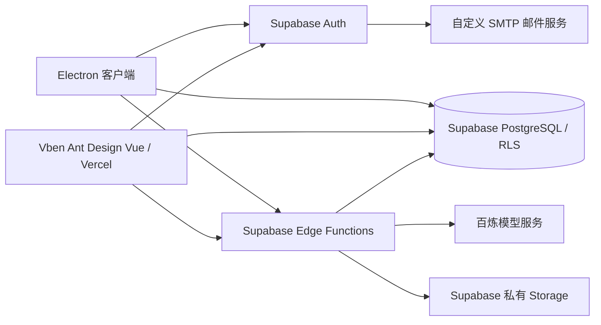

# 下班搭子：账号、用户画像与管理后台 PRD

日期：2026-11-11 · 状态：已按指定技术栈修订，尚未实施

## 1. 概要

面向中国大陆用户，为下班搭子建立邮箱验证码登录、渐进式用户画像和轻量网页管理后台。首版用于受控内测，同时把 AI 调用、额度与成本核算迁到服务端，为后续收费提供基础。

已确认：中国大陆优先；邮箱验证码；希望获得更详细的用户画像；管理后台使用 Vue Vben Admin 的 Ant Design Vue 版本；后端使用 Supabase；管理后台前端部署到 Vercel。暂以 Supabase 官方托管版作为方案基线，托管或自建及具体区域尚未最终确定，其余产品取舍为本方案建议。

## 2. 背景

当前 1.12.2 使用 Electron、React、TypeScript，工资、日历、聊天及剧情记忆保存在本机。现有 AI 中转仅监听本机地址，使用开发者配置的密钥，没有用户认证、账户数据库或多用户额度控制，不能原样作为公网服务。

本次要解决三个问题：让用户方便加入内测；让运营知道谁在使用、哪些功能有价值；让 AI 服务可以按账号控制权限与成本。保持角色设定由系统提供、用户仅修改角色名字的既有方向。

## 3. 目标与验证

1. 内测发布前，新用户注册、老用户登录、退出、撤销设备会话、换绑邮箱和注销流程全部通过端到端验证；验证码过期、重放、并发注册及频率限制均有覆盖。
2. 发布前，跨账号访问、本地数据隔离、数据库行级权限与管理员接口越权用例全部通过；可选问卷或统计被拒绝时不影响基础使用；发行客户端与网页资源不包含平台 AI 密钥或 Supabase 服务端密钥。
3. 每次云端 AI 请求可追踪账号、用途、结果及额度变动，重试不会重复记账；可取得供应商用量时记录实际用量，否则明确标记估算或待核对。首轮内测形成注册完成率、七日留存、功能使用和 AI 成本基线，再设增长目标。

## 4. 用户群

| 用户群 | 主要需求 |
| --- | --- |
| 新加入的桌面用户 | 快速登录、无需配置模型密钥，体验桌面陪伴和工作工具 |
| 已有本地数据的用户 | 保留工资、计划、角色名字和故事进度，明确登录对数据的影响 |

运营者是管理后台的使用方，需要处理账号问题、发现功能偏好、控制 AI 支出；不以查看私人内容作为运营方式。

## 5. 价值主张

| 要素 | 新用户 | 已有用户 |
| --- | --- | --- |
| 谁 | 新加入的桌面用户 | 已有本地数据的用户 |
| 为什么 | 希望低门槛体验陪伴与工作工具 | 希望升级后继续使用已有记录 |
| 之前 | 使用独立工具，AI 体验可能需自己配置 | 数据在本机，没有统一账户身份 |
| 如何 | 邮箱验证码登录，系统提供 AI 服务 | 保留本地资料，明确选择是否迁入当前账号 |
| 之后 | 能直接体验，知道额度和资料用途 | 账号间资料隔离，原有进度不丢失 |
| 替代选择 | 普通聊天应用与独立日历工具 | 继续使用旧版或手动备份 |

用户能方便地使用有连续角色体验的桌面搭子；运营能通过必要的服务记录和自愿提供的信息改进产品。

## 6. 方案

### 6.1 客户端流程

- 登录入口放在侧栏底部的账号区域，设置中增加“账号与隐私”。保留未登录的本地工资、日历和桌宠功能，云端 AI 需要登录。
- 登录与注册合并：邮箱 → 获取验证码 → 验证成功 → 新邮箱创建账号、已有邮箱直接登录。先完成适用的协议和服务准入流程，再进入 AI 功能。
- 首次登录后显示可跳过的三题问卷：行业/岗位大类、使用目的、最想使用的功能；班制、付费意愿等后续自愿补充。账号昵称与角色自定义名字分别保存。
- 账号页提供资料修改、可选统计开关、设备会话、换绑邮箱、导出、注销；无需设计密码找回。换绑和注销要求重新验证。
- 原有数据保留为本地资料；用户明确选择后再复制到指定账号的本机数据区，并保留迁移备份。账号切换必须关闭旧窗口会话、隔离缓存与文件。退出不自动删除本地资料，也不让其他账号自动继承。
- 首版登录不等于云同步：换电脑不会自动恢复工资、聊天或剧情。界面明确说明，继续提供本地备份能力。

### 6.2 用户画像与数据用途

| 数据层 | 首版内容 | 用途和控制 |
| --- | --- | --- |
| 账户必要信息 | 用户 ID、验证邮箱、状态、注册时间、会话及协议版本 | 登录、找回身份、支持与账户安全；邮箱默认脱敏展示 |
| 自愿填写的资料 | 行业/岗位大类、班制、使用目的、期望功能、付费意愿区间 | 了解需求；可跳过、修改、删除；不要求公司名、真实姓名或精确收入 |
| 必要服务记录 | AI 请求用途、用量、结果、耗时、额度变动、安全事件 | 提供服务、对账与防滥用；与可选产品统计分开说明 |
| 可选产品统计 | 功能使用次数、主动互动、常用角色、版本及运行环境 | 用户开启后采集，用于改进产品；不包含文本内容 |
| 本机业务内容 | 工资金额、计划正文、请假原因、聊天及长期记忆 | 不作为运营画像自动上传，不在后台提供任意浏览入口 |

AI 回复所需的当前消息及必要上下文仍会经过云端服务和模型供应商。首次启用时明确说明接收方、用途和保存安排；默认不把请求正文写入普通日志或长期画像，不自动用于训练。用户主动反馈时，另行选择是否附带某段对话。

画像标签区分“本人填写”和“根据使用记录计算”，后者显示统计窗口及依据，例如“近 30 天使用日历 12 天”。桌宠挂在后台不算主动使用；不从聊天推断健康、宗教、性偏好等隐私。收集范围、用途、保留期限及用户访问、更正、删除路径应按最小必要原则明确。[个人信息保护法](https://www.cac.gov.cn/2021-08/20/c_1631050028355286.htm)

可选原始使用事件建议保留 90 天，期满删除或转为无法回溯个人的汇总；账号资料、AI 对账与安全日志分别制定保留规则。注销立即撤销会话，再按规则删除或匿名化；依法需要保留的记录限制访问并解释期限，备份按公布周期到期清除。

### 6.3 管理后台

采用 [Vue Vben Admin](https://github.com/vbenjs/vue-vben-admin) 的 `apps/web-antd` 应用，使用 Vue、TypeScript、Ant Design Vue。保留其布局、表格、表单和权限界面基础，替换演示页面、模拟登录及示例接口。其页面与按钮权限只负责展示，实际授权由 Supabase 数据库和函数执行。上游采用 MIT 许可，分发时保留相应版权与许可声明。[应用依赖](https://github.com/vbenjs/vue-vben-admin/blob/main/apps/web-antd/package.json)、[许可证](https://github.com/vbenjs/vue-vben-admin/blob/main/LICENSE)

| 菜单 | 首版能力 |
| --- | --- |
| 概览 | 新增用户、主动活跃、七日留存、AI 请求成功率与成本；统计口径和样本覆盖可见 |
| 用户 | 搜索与筛选、脱敏账户详情、资料与标签来源、账号停用/恢复、撤销会话 |
| AI 与额度 | 内测每日额度、临时赠送、各用途消耗、账号和全局预算上限、异常请求；所有调整留痕 |
| 反馈与申诉 | 用户反馈、主动提交的附件、处理状态与回复记录、注销处理 |
| 系统 | 邀请码、注册开关、服务状态、管理员权限、操作审计 |

首版只设管理员与受限运营两种后台角色，管理员启用多因素验证。运营不能查看密钥、验证码或登录令牌；完整邮箱与资料导出受限且留痕。后台管理员身份与普通用户权限分离，服务端逐项检查权限。[认证安全参考](https://cheatsheetseries.owasp.org/cheatsheets/Authentication_Cheat_Sheet.html)

### 6.4 技术边界

| 部分 | 技术与职责 |
| --- | --- |
| 桌面客户端 | 现有 Electron + React，负责桌面角色、本地业务和账号界面 |
| 网页管理后台 | Vben `apps/web-antd`，独立工程与构建，部署到 Vercel |
| 账号 | Supabase Auth：邮箱验证码、会话、邮箱变更及管理员 MFA |
| 数据 | Supabase PostgreSQL：资料、同意记录、权益、使用流水、统计和审计 |
| 业务接口 | Supabase Edge Functions：AI 中转、额度管理、管理员操作、注销与导出 |
| 附件 | Supabase 私有 Storage：用户主动提交的反馈附件，按权限临时访问 |

**登录和邮件。** 使用 Supabase Auth 的 `signInWithOtp` 与 `verifyOtp`，邮件模板显示验证码，避免默认发送登录链接。验证码生成、校验和会话签发交由 Auth，不再自建验证码数据库或第二套令牌系统。验证码有效期建议五分钟、发送间隔六十秒，使用 Auth 支持的服务端限流并验证防重放效果；可选验证码或风控措施以大陆可用性实测为准。[邮箱验证码文档](https://supabase.com/docs/guides/auth/auth-email-passwordless)

内测前配置自定义 SMTP，可优先评估阿里云邮件推送。Supabase 默认邮件服务限制收件人和频率，不适合给普通内测用户发信。验证发信域名后测试 QQ、163、Outlook 等邮箱实际收信情况。[SMTP 限制](https://supabase.com/docs/guides/auth/auth-smtp)、[发信域名配置](https://help.aliyun.com/zh/direct-mail/user-guide/how-to-configure-sending-domain-names)

**数据与授权。** 认证身份由 `auth.users` 管理，自愿资料、同意记录、使用事件、AI 流水等分别建表。公开给 Data API 的表必须显式设置访问授权与 RLS；个人资料仅允许本人读写许可字段，额度流水不允许客户端修改。管理员角色、账户停用状态和审计放在受限的数据结构中，由服务端维护；不能用用户可编辑的 `user_metadata` 判断权限。后台敏感操作通过 Edge Functions 校验管理员身份、当前权限及 MFA，再执行并留痕；禁止把服务端密钥发给浏览器或桌面端。[RLS 文档](https://supabase.com/docs/guides/database/postgres/row-level-security)

桌面端在主进程接管会话保存与刷新，通过系统加密能力保护凭据。注销或停用先撤销刷新会话；已有访问令牌可能在到期前仍有效，因此敏感函数与数据策略还要检查当前账户/会话状态，不能仅依赖客户端退出或删除 Auth 用户。邀请/白名单资格在服务端准入流程执行，不能只隐藏注册按钮。

**AI 接口。** Edge Functions 使用 TypeScript/Deno，将现有本机 Node HTTP 中转中的纯业务逻辑适配为云端处理器。复用角色设定与流式协议，供应商密钥存入函数 secrets。角色卡版本、模型与额度由服务端决定；用数据库事务处理额度预占和结算，用请求 ID 防止重试重复记账，核算聊天、点击互动等全部用途。测试流式首字延迟、断线取消、超时及用量核对；函数有运行时长和资源限制，不把长时任务作为常驻进程运行。[Edge Functions](https://supabase.com/docs/guides/functions)、[运行限制](https://supabase.com/docs/guides/functions/limits)

**前端部署。** 保留 Vben 所需的上游 workspace 依赖，锁定采用的版本/提交与依赖锁文件，从其工作区根目录构建 `pnpm run build:antd`。Vercel 仅发布 Ant Design Vue 应用产物，实施时核验输出目录；首版保留 hash 路由。清除默认 mock API 和演示账号，接入真实 Supabase 服务。前端环境变量仅放项目 URL 与 publishable key，secret/service-role 和 AI 密钥仅在后端配置。Preview 连接测试环境，Production 连接正式环境。[构建脚本](https://github.com/vbenjs/vue-vben-admin/blob/main/package.json)、[上游环境配置](https://github.com/vbenjs/vue-vben-admin/blob/main/apps/web-antd/.env.production)

**区域和访问。** Supabase 托管版当前区域列表没有中国大陆节点，可先以新加坡作为候选进行测试；Vercel 官方也明确不保证大陆访问可用性。后台绑定自有域名、减少外部静态资源依赖，并分别实测三网下的 Auth、数据库、函数、邮件及百炼调用链。后台网页可用不代表客户端登录或 AI 可用，自定义域名也不能保证解决跨境网络问题。[Supabase 区域](https://supabase.com/docs/guides/platform/regions)、[Vercel 大陆访问说明](https://vercel.com/kb/guide/accessing-vercel-hosted-sites-from-mainland-china)

托管方案会涉及境外存储或处理账号、画像及请求上下文，需梳理各服务的数据流，确认告知、同意及适用的出境安排。若要求业务数据在境内存储和处理，可保留技术选型，改为境内部署自建 Supabase，并承担更新、备份和运维；不把这一备选视为已决定迁移。[个人信息跨境规则](https://www.cac.gov.cn/2021-08/20/c_1631050028355286.htm)、[Supabase 自建说明](https://supabase.com/docs/guides/self-hosting)

测试和生产分离，使用版本化数据库迁移及函数部署；配置单人/全局 AI 预算、备份恢复和异常告警。首版不另建常驻 Node 后端、独立向量数据库或非必要缓存服务。

### 6.5 发布前需落实的条件

当前角色具有持续人格与情感互动，推断需要评估《人工智能拟人化互动服务管理暂行办法》的适用性。该办法已于 2026 年 7 月 15 日施行，涉及年龄及必要联系人信息、未成年人保护、AI 身份提示、交互数据权利和上线安全评估。邮箱验证仅证明邮箱控制权；具体准入流程和评估义务应在面向公众开放前确认。[办法原文](https://www.cac.gov.cn/2026-04/10/c_1777558395078289.htm)

建议首轮邀请成年用户测试，但邀请制和自报年龄不自动替代适用的保护义务。需结合运营主体、功能和发行方式确认域名/服务备案要求；现有 Live2D 模型与 SDK 也需逐项核对分发及后续收费使用许可。

待落实的业务输入：运营主体、自有域名、Supabase 托管/自建与区域、Vercel 项目、SMTP 发信服务、首批人数和月度预算、服务准入及跨境数据安排、资料及日志保留政策。这些不阻碍方案讨论，但影响部署和公开发布。

## 7. 交付顺序

1. **工程与账号基础**：整理 Vben Ant Design Vue 后台工程，建立本地 Supabase 环境、数据结构及 RLS；接入 Auth、SMTP、客户端账号中心和本地账号隔离，用测试环境走通注册与退出。
2. **云端 AI**：把当前本机调用适配为认证后的 Edge Functions 调用，接入额度、限流、成本记录与预算上限。
3. **后台与画像**：完成 Vben 用户管理、自愿问卷、可选统计、额度调整、反馈与审计页面，替换全部模拟接口，建立 Vercel 测试部署。
4. **受控内测**：完成适用的发布准备，验证大陆访问、邮件送达、RLS 和管理员越权防护、账号隔离、注销、备份恢复及 AI 费用核对，再逐批邀请用户。

以上是同一首版的交付批次，首版整体可内测时才算完成；先不承诺工期，待资源与准入范围确定后估算。支付、订单、自动订阅续费、第三方登录和跨设备云同步留待后续，首版仅建立可扩展的权益与用量记录。
